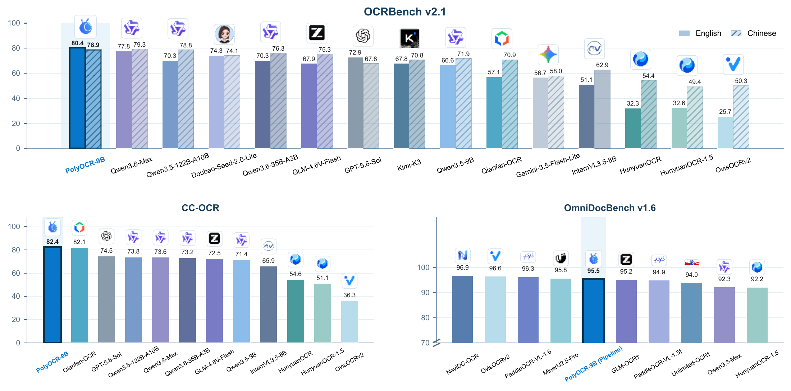
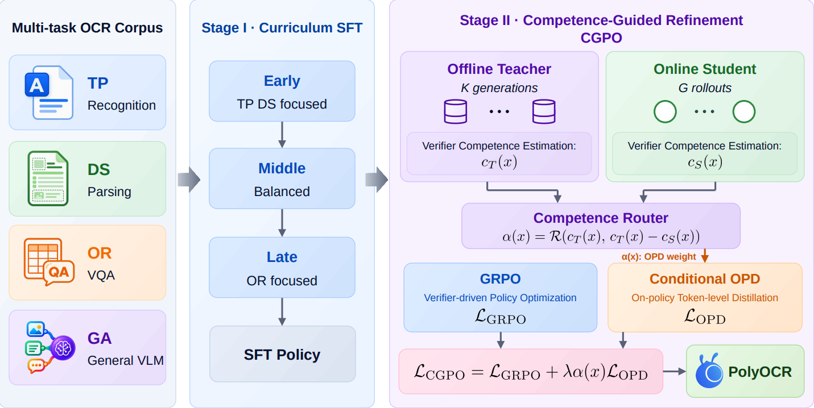

<p align="center">
  
</p>

---

<p align="center">
  <a href="docs/PolyOCR-Venus.pdf">📄 Technical Report</a> •
  <a href="#overview">✨ Overview</a> •
  <a href="#benchmark-results">📊 Results</a> •
  <a href="evaluation/ocrbench_v2/README.md">🛠️ Evaluation Guide</a> •
  <a href="#citation">📚 Citation</a>
</p>

<h2 align="center">
  PolyOCR-Venus: Unified OCR Foundation Models<br>
  for Text-Centric Visual Intelligence
</h2>

<p align="center"><b>GuangJian Team, Ant Group</b></p>

<p align="center">
  
</p>

*Cross-benchmark comparison on OCRBench v2.1, CC-OCR, OmniDocBench v1.6, in-house KIE, and MDPBench. OmniDocBench uses the PolyOCR-9B layout-guided pipeline; MDPBench uses PolyOCR-2.7B. CC-OCR excludes multilingual OCR, and truncated axes are marked. See [Benchmark Results](#benchmark-results) for end-to-end scores and protocol details.*

**PolyOCR-Venus** brings text recognition, localization, document parsing, information extraction, multilingual transformation, and OCR-centric reasoning into one instruction-following model family.

## Release

- **2026-09-21:** Technical report and OCRBench evaluation code are available in this repository, together with dependency files and a setup guide.

## Contents

- [Overview](#overview)
- [Capabilities](#capabilities)
- [Training Framework](#training-framework)
- [Benchmark Results](#benchmark-results)
- [Evaluation](#evaluation)
- [Citation](#citation)
- [Acknowledgments](#acknowledgments)
- [License](#license)

## Overview

PolyOCR is a family of **2B and 9B** OCR foundation models built on the **Qwen3.5** vision-language backbone. A shared instruction-following interface supports tasks ranging from reading individual text regions to recovering document structure and reasoning over visual text.

- **Unified OCR capabilities.** Six capability groups cover text perception, spatial grounding, structured understanding, extraction, transformation, and reasoning across scenes, documents, tables, charts, and diagrams.
- **Large-scale OCR data construction.** Curated OCR resources are complemented by controlled synthesis, model-assisted annotation, and quality verification, forming a corpus of approximately **60 million SFT instances**.
- **Competence-Guided Policy Optimization (CGPO).** Post-training combines verifier-based Group Relative Policy Optimization (GRPO) with adaptive on-policy distillation, routing teacher supervision according to teacher reliability and the teacher–student competence gap.

The [technical report](docs/PolyOCR-Venus.pdf) describes the model family, data construction, training method, and evaluation across OCRBench v2.1, CC-OCR, and OmniDocBench v1.6. The code currently provided here is the [OCRBench evaluation module](evaluation/ocrbench_v2/README.md); model weights, training code, and the CC-OCR/OmniDocBench pipelines are not included in this release.

## Capabilities

| Capability | Representative tasks |
| --- | --- |
| Text recognition | Scene text, handwriting, multilingual OCR, full-page transcription |
| Text localization and spotting | Detection, grounding, referring text localization, region recognition, text spotting |
| Structured document understanding | Layout and reading order, document parsing, tables, formulas, charts |
| Information extraction and semantic relations | Entity extraction, key information extraction, key–value association, forms |
| Visual-text understanding and transformation | Document VQA, chart/table understanding, classification, translation |
| OCR-centric reasoning | Counting, arithmetic over visible values, spatial reasoning, multi-step inference |

## Training Framework

<p align="center">
  
</p>

1. **Curriculum supervised fine-tuning.** Approximately 60 million instances are organized into three phases. The curriculum gradually shifts emphasis from text perception and document structure toward OCR understanding and reasoning, while retaining general multimodal alignment data.
2. **Competence-guided post-training.** CGPO uses verifier rewards to estimate student competence and cached teacher generations to estimate teacher competence. A calibrated router controls the distillation weight for each sample; verifier-based GRPO remains active throughout. Both model variants use Qwen3.5-122B-A10B as the teacher for this stage.

See the technical report for the data engine, routing formulation, and training settings.

## Benchmark Results

Selected **end-to-end** results from the technical report are shown below. Higher is better in every column.

| Model | OCRBench v2.1 EN | OCRBench v2.1 ZH | CC-OCR | OmniDocBench v1.6 |
| --- | ---: | ---: | ---: | ---: |
| Qwen3.5-2B | 54.03 | 63.75 | 65.66 | 79.95 |
| Qwen3.5-9B | 66.64 | 71.88 | 71.44 | 89.49 |
| **PolyOCR-2B** | **72.33** | **71.32** | **80.53** | **88.12** |
| **PolyOCR-9B** | **80.42** | **78.87** | **82.43** | **91.57** |

**Layout-guided document parsing.** With PP-DocLayoutV3 providing layout regions and reading order, PolyOCR-9B parses cropped text, formula, and table regions and assembles the results into Markdown. This pipeline reaches **95.48** on OmniDocBench v1.6, compared with **91.57** for direct full-page inference.

**OCRBench protocol.** In this report, **OCRBench v2.1** denotes our revision of OCRBench v2: audited and corrected reference annotations together with task-aligned scoring procedures. It preserves the original task coverage. These scores should be compared only with results using the same revised annotations and protocol; original OCRBench v2 scores are not directly comparable. The report appendix documents the changes.

## Evaluation

OCRBench evaluation is one component of the PolyOCR project. The implementation is organized under [`evaluation/ocrbench_v2/`](evaluation/ocrbench_v2/README.md) and includes:

- PolyOCR two-stage inference configurations: thinking disabled for parsing/recognition and enabled for question answering/reasoning.
- OpenAI-compatible API inference with resumable runs and prediction export.
- Scoring for OCR, VQA, document/table/formula parsing, key information extraction, localization, and spotting, including TEDS and CDM.
- Translation/QA judging, subset rescoring, result merging, and dependency checks.

The revised dataset is included locally as `evaluation/ocrbench_v2/data/ocrbench_v21.tsv` (10,000 samples with base64-embedded images; stored with Git LFS due to its ~1.4 GB size). To reproduce the report's **v2.1** protocol, use this dataset together with the matching scoring/judge settings described in the evaluation guide. Model weights and API credentials must be supplied separately.

### Installation

Run from the repository root in a Linux environment with Python 3.11 or later:

```bash
# Fetch the OCRBench v2.1 dataset (requires Git LFS)
git lfs install
git lfs pull

python3 -m venv .venv
source .venv/bin/activate
python -m pip install -r requirements.txt
```

| Dependency file | Use case |
| --- | --- |
| [`requirements.txt`](requirements.txt) | Default entry point for the full OCRBench evaluation environment |
| [`requirements_api.txt`](evaluation/ocrbench_v2/requirements_api.txt) | Standalone API inference only |
| [`requirements_vllm.txt`](evaluation/ocrbench_v2/requirements_vllm.txt) | Local vLLM inference and evaluation |

Full scoring also requires TeX Live components for CDM and NLTK corpora for handwriting metrics. Follow the **[evaluation guide](evaluation/ocrbench_v2/README.md)** for data preparation, API configuration, inference, scoring, and dependency checks.

### Repository Layout

```text
PolyOCR-Venus/
├── README.md
├── requirements.txt
├── assets/                         # Project logos and report figures
├── docs/
│   └── PolyOCR-Venus.pdf
└── evaluation/
    └── ocrbench_v2/                 # Evaluation code, configs, scripts, and guide
```

## Citation

If you use PolyOCR or its evaluation protocol in your research, please cite the technical report:

```bibtex
@article{team2026polyocr,
  title={PolyOCR-Venus: Unified OCR Foundation Models for Text-Centric Visual Intelligence},
  author={Team, GuangJian and Huang, Kaili and Zhang, Yongshuo and Fu, Bingtao and Jiang, Changjiang and Qu, Chenfan and Zhang, Chenfeng and Cui, Fangming and Zhang, Gaoyang and Xie, Jiangwei and others},
  journal={arXiv preprint arXiv:2609.37712},
  year={2026}
}
```

## Acknowledgments

PolyOCR builds on Qwen3.5 and uses OCRBench, CC-OCR, and OmniDocBench for evaluation. The included evaluation framework is adapted from VLMEvalKit; its [upstream documentation](evaluation/ocrbench_v2/README.upstream.md), [license](evaluation/ocrbench_v2/LICENSE), and [source manifest](evaluation/ocrbench_v2/SOURCE_MANIFEST.json) are retained with the code.

## License

The open-source code in this project is licensed under **GPL-2.0**. **OCRBenchV2.1** is licensed under **MIT**. Third-party components retain their original licenses; the included VLMEvalKit framework is licensed under Apache-2.0 (see [its license](evaluation/ocrbench_v2/LICENSE)).

本项目的开源代码采用 **GPL-2.0** 协议；**OCRBenchV2.1** 采用 **MIT** 协议。第三方组件保留各自的原始协议。
